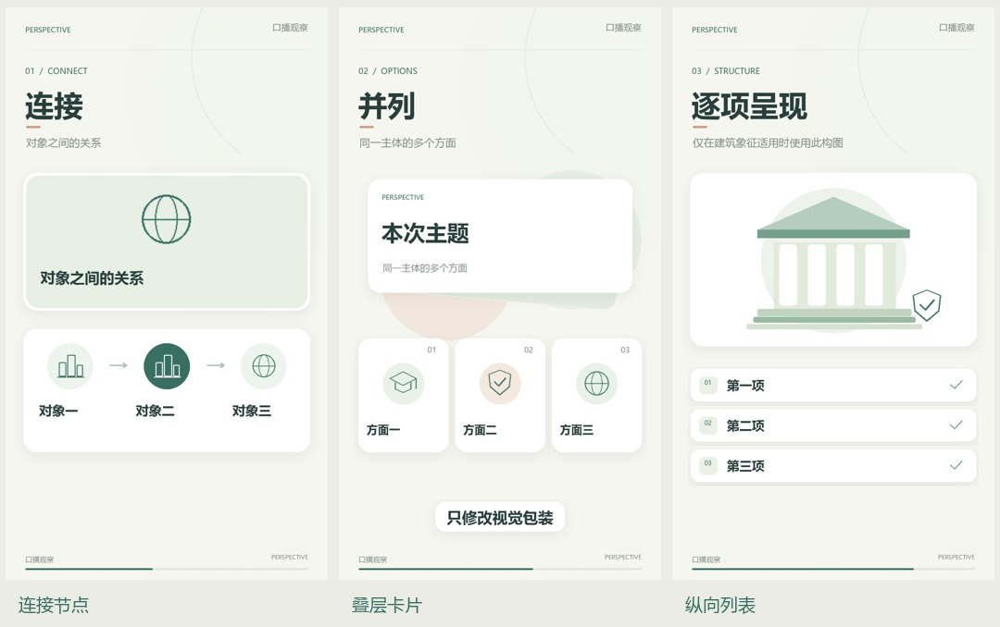

# 浅色口播剪辑

`light-talk-video-edit` 把竖屏口播制作成米白、鼠尾草绿与杏色点缀的浅色卡片视频，适合人物标题、资料配图、连接节点、并列卡片和纵向图解。也支持保持既有剪切和音频，只重新设计包装。



## 下载与安装

[下载独立技能包](https://github.com/zhoujinjinhao1-collab/netfeel-talking-head-edit/raw/refs/heads/main/downloads/light-talk-video-edit.zip)，解压后把完整的 `light-talk-video-edit` 文件夹放入你的 Codex 技能目录。使用自定义 `CODEX_HOME` 时，对应目录是 `$CODEX_HOME/skills`。

也可以克隆仓库后只复制本技能：

```powershell
git clone https://github.com/zhoujinjinhao1-collab/netfeel-talking-head-edit.git
Copy-Item -LiteralPath .\netfeel-talking-head-edit\skills\light-talk-video-edit -Destination "$env:USERPROFILE\.codex\skills\light-talk-video-edit" -Recurse
```

macOS / Linux 的常用安装位置是 `~/.codex/skills/light-talk-video-edit`；将整个子目录复制过去即可。已有同名安装时，先保留需要的自定义文件再更新。

## 依赖与使用

脚本需要 Python 3.10+、Pillow、NumPy、支持 H.264/AAC 的 FFmpeg，以及覆盖口播语言的字体；不需要 Node.js 或浏览器。以下命令在本技能目录执行，建议在虚拟环境安装依赖：

```text
python -m pip install -r scripts/requirements.txt
```

Windows 默认尝试微软雅黑。macOS / Linux 可在项目配置的 `fonts.regular` 和 `fonts.bold` 中填写本机中文字体路径；也可以使用[仓库附带的中文字体](https://github.com/zhoujinjinhao1-collab/netfeel-talking-head-edit/blob/main/assets/fonts/IBMPlexSansSC-SemiBold.otf)，遵守[对应的 OFL 许可](https://github.com/zhoujinjinhao1-collab/netfeel-talking-head-edit/blob/main/assets/fonts/OFL-IBM-Plex.txt)。字体、FFmpeg 与语音识别模型不在独立技能包内。

把视频提供给可访问本地文件并执行命令的助手，例如：

```text
用 $light-talk-video-edit 处理我提供的口播。
采用浅色卡片和分步图解，先做一版可播放的试剪。
保留原声，检查字幕与人物小窗的取景。
```

手动渲染时，复制 [示例配置](assets/example-project.json) 到项目目录，替换本次视频路径、字幕、分镜和配图，再运行：

```text
python scripts/render_light.py --config project.json --check
python scripts/render_light.py --config project.json --preview
python scripts/render_light.py --config project.json
python scripts/verify_video.py output.mp4 --expected-duration 12
```

示例的 12 秒时间轴仅用于展示配置格式，不能代替当前视频的真实字幕或分镜。`ffmpeg` 可写入配置或通过 `FFMPEG_EXE` / PATH 指定。需要本地转录时，自备可用的语音识别工具，或提供已校对字幕。

默认快速试剪为 720×1280、25fps，输出 MP4、SRT、计划 JSON 与关键帧。它不生成剪映/PR 原生工程，也不全自动完成语义分镜与事实核查。更多参数见[配置与执行](references/rendering.md)。

## 许可与隐私

代码、文档和本地绘制的示意图沿用仓库 [MIT 许可](LICENSE)。此包只包含通用指令、示例配置、设计参考和渲染器，不包含用户口播、私人原片、成片、账号凭据、系统字体或语音模型。每次制作使用的外部配图、音乐和声音需单独记录来源。
